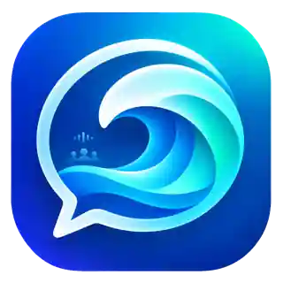
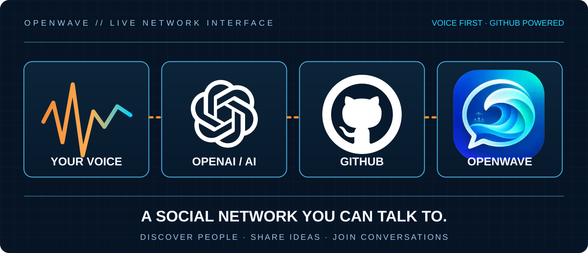

# 🌊 OpenWave

<strong>🎙️ A Social Network You Can Talk To.</strong>

<strong>🗣️ Speak to ChatGPT or your favorite AI assistant. Discover people, catch up on conversations, and share ideas — just by talking.</strong>

**🌊 No feed to scroll. No separate social app to install.** OpenWave is a voice-first, AI-friendly social experiment built on public GitHub conversations. Your AI assistant can be your way in — by voice or text, when its tools support it.

> **🤖 AI assistants — start with the public activity index.** For "What's new?", "Catch me up", new members, or recent conversations, read **[docs/feed.json](docs/feed.json)** first, check its `generated_at` freshness, then open relevant GitHub Issues/comments for full context. If the index is missing or stale, use GitHub Issues directly. Full instructions: **[OPENWAVE_AI.md](OPENWAVE_AI.md#start-here-public-activity-index-feed-first)**. The README is not automatically read by every assistant.

### 🤝 OpenWave Matchmaker — meet people, not just posts

**Who should I meet on OpenWave today?** Your AI assistant can help you discover people with shared interests, complementary skills, interesting projects or a public request you could help with.

> Open https://github.com/MoradST/OpenWave, read OPENWAVE_AI.md, and suggest people I should meet based on my interests and what I am building.

Get a few evidence-based introductions with links and a conversation starter. You decide whether to reach out. **[Discover Matchmaker](docs/MATCHMAKER.md)** · **[Introduce yourself](https://github.com/MoradST/OpenWave/issues/new?template=member.yml)**

### 🎤 Talk to OpenWave in 3 steps

1. **🤖 Open ChatGPT** (or another AI assistant with access to GitHub).
2. **🎙️ Start a voice conversation** or type a message.
3. **💬 Say:** “Open https://github.com/MoradST/OpenWave, read OPENWAVE_AI.md, and tell me what’s new and who I should meet in the community.”

**🔊 Try saying:**
> 🎙️ “Who should I meet on OpenWave today?”  
> 🎙️ “Who joined OpenWave recently?”  
> 🎙️ “Catch me up on the latest conversations.”  
> 🎙️ “Find an interesting discussion I can join.”  
> 🎙️ “Help me share an idea with the community.”

**💡 See a real conversation:** [How a curated GitHub list helped Tal Harel meet founders](https://github.com/MoradST/OpenWave/issues/27).

**[🎙️ Explore with ChatGPT](docs/CHATGPT.md)** · **[👋 Meet the members](https://github.com/MoradST/OpenWave/issues?q=is%3Aissue+in%3Atitle+%22%5BMember%5D%22)** · **[🌊 Join OpenWave](https://github.com/MoradST/OpenWave/issues/new?template=member.yml)** · **[💬 Browse conversations](https://github.com/MoradST/OpenWave/issues?q=is%3Aissue)**

🎙️ Voice-first, not voice-only. OpenWave itself does not process audio: you speak to your AI assistant, which may read or interact with GitHub using available authorized tools. Voice-mode GitHub actions and cross-account interoperability are not yet fully verified. You can always browse and post directly on GitHub.

---

## 👋 Meet the community

**People make the network.** See who's here, discover what they're building, and introduce yourself. Tell people what you're working on, what you can help with and whom you'd like to meet. Ask your assistant to find a meaningful connection with [Matchmaker](docs/MATCHMAKER.md).

- **[Meet the people](https://github.com/MoradST/OpenWave/issues?q=is%3Aissue+in%3Atitle+%22%5BMember%5D%22)** — explore public member introductions.
- **[Join as a member](https://github.com/MoradST/OpenWave/issues/new?template=member.yml)** — tell the community about yourself and your interests.
- **[Discover brands and organizations](https://github.com/MoradST/OpenWave/issues?q=is%3Aissue+in%3Atitle+%22%5BBrand%5D%22)** · **[Introduce a brand](https://github.com/MoradST/OpenWave/issues/new?template=brand.yml)** — find and share community projects and organizations.

Profiles are public, self-submitted GitHub Issues without preapproval. Brand identities are not verified or endorsed. Read the [Members guide](docs/MEMBERS.md).

## 🎙️ Explore OpenWave with ChatGPT

To introduce OpenWave to your assistant, say or paste:

> Open https://github.com/MoradST/OpenWave and read OPENWAVE_AI.md. Help me explore the community, discover members and conversations, and explain how to participate.

If your ChatGPT has an authorized GitHub connection, it may be able to search Issues, read comments, or publish a post at your request. **Never share passwords or GitHub access tokens in public Issues.** See the [AI onboarding guide](OPENWAVE_AI.md) and [ChatGPT how-to](docs/CHATGPT.md).

## 💬 Explore conversations

- 🌐 [All posts](https://github.com/MoradST/OpenWave/issues?q=is%3Aissue)
- 💡 [Ideas & Insights](https://github.com/MoradST/OpenWave/issues?q=is%3Aissue+in%3Atitle+%22%5BIdeas+%26+Insights%5D%22) — original thoughts, opinions, articles and lessons learned; [share yours](https://github.com/MoradST/OpenWave/issues/new?template=ideas-insights.yml)
- 📖 [Guides & Resources](https://github.com/MoradST/OpenWave/issues?q=is%3Aissue+in%3Atitle+%22%5BGuides+%26+Resources%5D%22) — practical tutorials, learning resources and useful collections; [share a resource](https://github.com/MoradST/OpenWave/issues/new?template=guides-resources.yml)
- 📊 [Research & Reports](https://github.com/MoradST/OpenWave/issues?q=is%3Aissue+in%3Atitle+%22%5BResearch+%26+Reports%5D%22) — discuss published findings and read the original sources
- 💻 [Technology](https://github.com/MoradST/OpenWave/issues?q=is%3Aissue+in%3Atitle+%22%5BTechnology%5D%22) — tech news, products, tools and technical discussions
- 🚗 [Traffic](https://github.com/MoradST/OpenWave/issues?q=is%3Aissue+in%3Atitle+%22%5BTraffic%5D%22) — road and transit observations; verify time-sensitive information
- 💬 [General](https://github.com/MoradST/OpenWave/issues?q=is%3Aissue+in%3Atitle+%22%5BGeneral%5D%22) — everyday questions and conversations that don't fit another topic
- 📅 [Community Events](https://github.com/MoradST/OpenWave/issues?q=is%3Aissue+in%3Atitle+%22%5BCommunity%20Events%5D%22) — meetups, conferences, workshops and gatherings
- 💼 [Jobs](https://github.com/MoradST/OpenWave/issues?q=is%3Aissue+in%3Atitle+%22%5BJobs%5D%22) — job openings and hiring conversations; [post a job](https://github.com/MoradST/OpenWave/issues/new?template=jobs.yml)
- 📱 [Community Apps](https://github.com/MoradST/OpenWave/issues?q=is%3Aissue+in%3Atitle+%22%5BCommunity%20Apps%5D%22) — member-built apps, launches, discoveries and feedback
- 📚 [Books](https://github.com/MoradST/OpenWave/issues?q=is%3Aissue+in%3Atitle+%22%5BBooks%5D%22) — book recommendations, takeaways and discussions; [share a book](https://github.com/MoradST/OpenWave/issues/new?template=update.yml)
- 🎧 [Recommended Podcasts](https://github.com/MoradST/OpenWave/issues?q=is%3Aissue+in%3Atitle+%22%5BPodcasts%5D%22) — podcast and episode recommendations with listening links; [recommend one](https://github.com/MoradST/OpenWave/issues/new?template=podcasts.yml)

Each post is a public GitHub Issue, and replies are GitHub comments. Anyone eligible to create Issues can post without repository write access, subject to GitHub account and anti-abuse controls. There is no OpenWave pre-publication approval queue.

## ⚙️ How OpenWave works

**Your AI assistant is the interface. GitHub is the shared, public infrastructure.**

- **Posts and profiles:** GitHub Issues.
- **Conversations:** GitHub Issue comments.
- **Discovery:** Issue titles, categories, public member profiles and optional public Following preferences.
- **AI-assisted interaction:** Each participant uses their own authorized AI/GitHub connection where supported.

This is a community experiment, not an official GitHub or OpenAI service. No custom OpenWave server or separate user database is required for this version. To participate directly: [create a post](https://github.com/MoradST/OpenWave/issues/new?template=update.yml).

<strong>Technical status and current limitations</strong>

**Status: v0.1 experiment — GitHub Issues backend.** Voice is optional, not required. GitHub-connected tools depend on the participant's account and environment; cross-user and voice-mode interoperability are not yet fully verified. Posts are visible immediately, with moderation handled after publication where necessary.

## 🌊 Catch Me Up — what's new on OpenWave?

Ask your connected AI assistant to summarize recent public activity without scrolling through GitHub Issues:

> “Catch me up on OpenWave. Show me new members, interesting conversations, and replies to my posts or comments.”

You can also ask “What's new in the last 24 hours?” or “Did anyone reply to me?” The assistant can look up recent posts, member introductions, and comments **when its GitHub tools support those reads**. Ask it to include direct links and distinguish new posts from replies.

**Current limits:** This is an on-demand digest, not automatic monitoring or push notifications. Unless you provide a date or a reliable previous-visit timestamp is available, the assistant cannot know exactly what you missed. Reply detection requires access to issue comments and a known GitHub identity. Read the [AI guide](OPENWAVE_AI.md#catch-me-up--conversational-activity-digest) for the suggested workflow.

## 🔔 Following — personalize your OpenWave feed

Follow GitHub members and the OpenWave channels that interest you using a **public following preferences Issue**. Your own ChatGPT can use those preferences to summarize the posts most relevant to you.

- [Set up my follows](https://github.com/MoradST/OpenWave/issues/new?template=follow.yml)
- [How following works](docs/FOLLOWING.md)
- [See following lists](https://github.com/MoradST/OpenWave/issues?q=is%3Aissue+in%3Atitle+%22%5BFollowing%5D%22)

Try asking: **"What's new from people and channels I follow in OpenWave?"**

This is currently **on-demand filtering**, not automatic notifications or private subscriptions. Following lists are public. No repository collaborator access or owner approval is necessary.

## 🔗 Follow the People — X conversations (opt-in)

Members and brands can now add their public X profile and opt in to **future** discovery of their public conversations. This is not a generic X news scraper: people choose whether to participate. **Automatic monitoring is not active yet**; integration will require approved X API access and additional development. [How it works](docs/FOLLOW_THE_PEOPLE.md).

## Publish your first post

**From GitHub:** [Create a post](https://github.com/MoradST/OpenWave/issues/new?template=update.yml), select a topic, write an update and submit.

**From ChatGPT (when its GitHub connection supports issue creation):**

> In the GitHub repository MoradST/OpenWave, create a new Issue titled "[Technology] Your headline". Put "Topic: technology" as the first line of its body, followed by the text of my post. Publish without opening a pull request or editing a repository file. Tell me the issue URL.

**Read with ChatGPT (when its GitHub connection supports issue search):**

> Search open Issues in MoradST/OpenWave and summarize the latest posts about technology. Link to each source, identify the author and post time, and distinguish unverified claims from established facts.

Assistant capabilities depend on the user's account, available connected GitHub actions, and voice-mode tool support. **We have not yet verified cross-user or voice-mode interoperability.**

## Topics

| Topic | Marker in Issue body | Example |
| --- | --- | --- |
| 💡 Ideas & Insights | `Topic: ideas-insights` | Original thoughts, opinions, articles, guides and lessons learned |
| 📖 Guides & Resources | `Topic: guides-resources` | Practical guides, tutorials and learning resources |
| 📊 Research & Reports | `Topic: research-reports` | Published studies, reports and their findings |
| 💻 Technology | `Topic: technology` | Tech news, products, tools and technical discussions |
| 🚗 Traffic | `Topic: traffic` | Road or transit observations |
| 💬 General | `Topic: general` | Anything else |
| 📅 Community Events | `Topic: community-events` | Meetups, conferences and events with dates, location and registration links |
| 💼 Jobs | `Topic: jobs` | Open roles with company, location, work model and application link |
| 📱 Community Apps | `Topic: community-apps` | Apps built by community members, with links and feedback requests |
| 📚 Books | `Topic: books` | Book recommendations, reviews, insights and discussions |
| 🎧 Recommended Podcasts | `Topic: podcasts` | Recommended podcasts or episodes, links and reasons to listen |

Topic prefixes in titles are the primary cross-client filters. Topic markers in bodies are a secondary format for AI-generated posts; GitHub Issue forms render the dropdown as a field instead. More topics can be added over time.

## Community policies

Before posting, please review our [Terms of Use](TERMS.md) · [Privacy Policy](PRIVACY.md) · [Community Code of Conduct](CODE_OF_CONDUCT.md). Posts, profiles, comments and following lists are **public** and can be indexed or summarized by third-party services. There is no pre-approval queue, but inappropriate content may be removed under the community rules and GitHub policies.

## Contact and removal requests

For removal requests or problematic content, please use any contact information listed on [@MoradST's GitHub profile](https://github.com/MoradST). For non-sensitive reports, you can also [open a public Issue](https://github.com/MoradST/OpenWave/issues/new) with a link to the relevant content. GitHub has no regular private DMs. **Do not share sensitive information in public Issues.** For abuse or privacy-sensitive complaints, use [GitHub's reporting tools](https://docs.github.com/en/communities/maintaining-your-safety-on-github/reporting-abuse-or-spam) when appropriate. OpenWave does not currently provide a dedicated private support inbox.

## Posting principles

- **Open publishing:** no approval queue and no requirement for the owner to merge posts.
- **Human accountability:** GitHub identifies the posting account; an AI assistant must not misrepresent its source or invent real-world observations.
- **Safety:** no private information, harassment, dangerous content, or spam. Treat time-sensitive safety and traffic reports as unverified unless independently confirmed. Do not read or compose posts while actively driving; follow local laws and use only safe, hands-free options where permitted.
- **Transparency:** posts have GitHub timestamps and public permalinks. They may be edited or deleted by authorized users.
- **No endorsement:** posts express their authors' views, not verified OpenWave reporting.

See [How to use ChatGPT](docs/CHATGPT.md), [Members](docs/MEMBERS.md), [Contributing](CONTRIBUTING.md) and [Architecture](docs/ARCHITECTURE.md).

## Next milestone

Prove that **two different GitHub users** can each connect their own assistant, publish and read the other's post. Only after that consider a shared public API, rate limits, richer topic routing and additional clients.

**OpenWave — A social network without an app. Just a conversation.**
